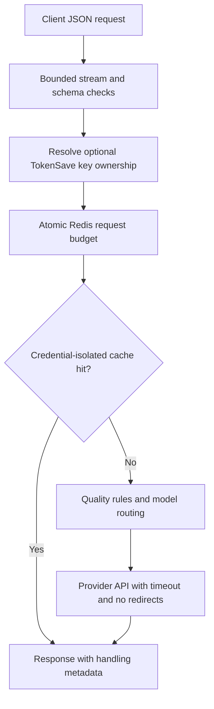

# Architecture and trust boundaries

TokenSave is a Next.js application with a custom JSON API. It is not an OpenAI-compatible drop-in proxy. Bring-your-own-key provider credentials are supplied per request; cache identifiers use a credential-keyed HMAC rather than storing the credential in the cache key.

## Proxy request path

`app/api/proxy/route.ts` implements this flow. `app/api/batch/route.ts` calls the same local handler, so items share its limits and credentials do not get forwarded to a hardcoded public instance. Provider fallback responses are not cached as if they came from the original model.

## Account operations

The dashboard sends a Supabase access token. Protected routes verify it with Supabase's user endpoint before using the returned account ID. Client-supplied IDs cannot select another account. Key provisioning and rotation use Redis Lua; audit access requires the stored key to remain current. Statistics and logs are account-scoped.

Anonymous BYOK proxy requests are supported but are not assigned to a caller-selected account. Their budget is per provider credential, not per person. A valid TokenSave key attributes requests to the verified owner.

## Failure behavior

| Boundary | Behavior |
| --- | --- |
| Missing or invalid account session | Reject with 401; no account access |
| Claimed account mismatch | Reject with 403 |
| Limiter storage unavailable or malformed | Reject with 503 before a provider call |
| Exhausted request budget | 429 with Retry-After |
| Oversized streamed body | Cancel the stream and reject with 413 |
| Arbitrary webhook egress | Disabled until safe delivery is designed |

## Verification and limits

Unit and route tests live in `tests/`. Required CI also runs the limiter and key-rotation scripts against an isolated real Redis service, including simultaneous calls. Provider billing, live model quality and all authenticated user journeys are separate integration concerns. See [security hardening](SECURITY_HARDENING.md) for verified checks and remaining production work.
